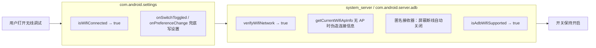

# ADB Wireless Debug Unblocker（LSPosed 模块）

允许在**未连接无线局域网（Wi-Fi）**时打开 Android 的「无线调试（ADB over Wi-Fi）」开关。
同时挂钩 **Settings 应用**与 **system_server** 两层，绕过「必须已连 Wi-Fi」的软件门槛。

此模块功能为允许打开此开关而不是（通过设置 adb tcpip 端口等方式）自动打开此开关；用户手动启用开关后体验与原生无线调试无异，支持 mTLS、mDNS 等所有特性。

源码拦截点的完整审计见 [AUDIT.md](./AUDIT.md)。

## 工作原理（两层放行）



## 工程结构

```
WirelessDebugUnblocker/
├── settings.gradle
├── build.gradle                  # 顶层，声明 AGP
├── gradle.properties
├── AUDIT.md                      # AOSP API36 拦截点审计（含文件:行号）
└── app/
    ├── build.gradle
    └── src/main/
        ├── AndroidManifest.xml   # xposedmodule / xposedminversion / xposedscope
        ├── assets/xposed_init    # 入口类全限定名
        ├── res/values/           # app_name / module_description / xposedscope
        └── java/com/unblock/wirelessdebug/MainHook.java
```

## 构建

1. 用 Android Studio（建议 Hedgehog 及以上，AGP 8.7.x，JDK 17）打开本目录，Gradle Sync。
2. `app/build.gradle` 使用 `compileOnly 'de.robv.android.xposed:api:82'`（API 由 LSPosed 运行时提供，**不能**打包进 APK）。
   - 若该坐标无法解析（jcenter 已停服）：把 `api-82.jar` 放入 `app/libs/`，并把依赖改为
     `compileOnly fileTree(dir: 'libs', include: ['*.jar'])`。
3. 直接 `Build > Build APK`，安装到已 Root + LSPosed（Zygisk）的设备。

## 在 LSPosed 中启用（关键）

1. LSPosed 管理器 → 模块 → 启用 **Wireless Debug Unblocker**。
2. 作用域勾选（本模块已在清单里声明，管理器一般会自动带出；若手动选择）：
   - **系统框架** —— 对应 legacy 包名 `android`。
   - **设置 / com.android.settings**
3. **重启设备**（system_server 钩子必须重启后生效）。

## 验证

- 断开 Wi-Fi（甚至关闭 Wi-Fi 开关），进入「设置 → 系统 → 开发者选项 → 无线调试」，开关应能打开并保持开启，不再弹「未连接网络」。
- LSPosed 日志过滤 tag `WDBlocker`，可看到每个钩子的命中记录（`hooked ...#method xN`）。

## 边界与免责

- 本模块只移除「必须已连 Wi-Fi」的**软件门槛**，不会凭空创建网络。
- 真正 `adb pair` / `adb connect` 仍需网络：已连 Wi-Fi、本机热点、流量（无需打开热点）、以太网，或 USB 反向网络共享。完全离线时开关可开、页面可进，但无法配对/连接。
- 仅用于个人设备调试与学习；自行承担使用风险。

## 兼容性

- 目前已在目标 AOSP API 36（Android 16）上测试。钩子全部按「方法名 + 存在性匹配」实现，ROM 微调签名时自动跳过并记日志，不会导致系统崩溃；个别厂商改包名/类名时对应层静默失效，可据 `WDBlocker` 日志调整。
- minSdk Android 11
